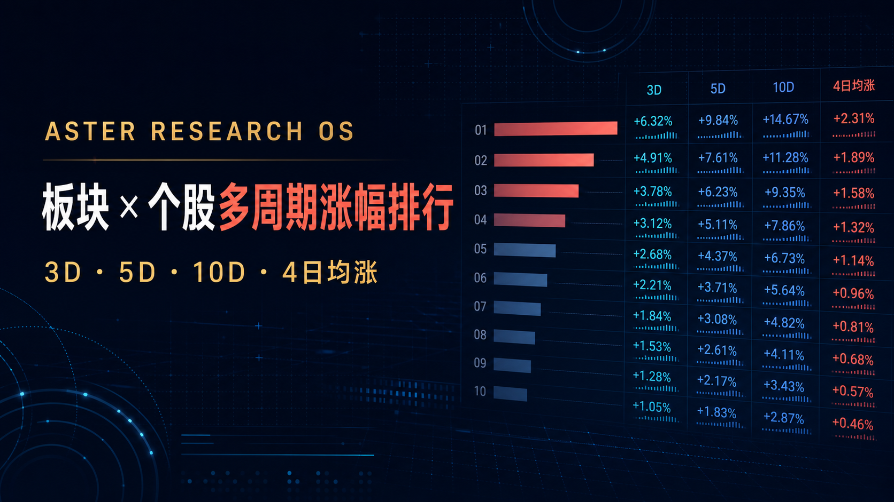
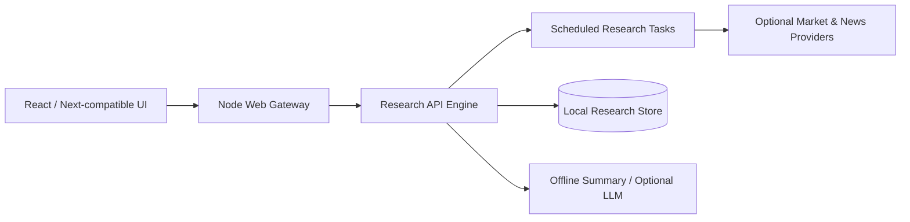

# Aster Research OS



一个面向 A 股研究流程的全栈投研工作台，将行情观察、因子筛选、候选信号、技术形态、公开信息跟踪和 AI 证据归纳集中到统一界面。

> 本仓库是用于作品集与技术交流的脱敏源码快照。真实行情数据库、账户凭据、Cookie、私有模型、生产缓存和历史备份均未提交。界面与输出仅用于研究辅助，不构成投资建议。

## 项目亮点

- **统一研究入口**：新闻总览、推荐信号、涨幅排名、量价筛选、技术分析、高手跟踪、模拟账户和 AI 投研共用一套交互框架。
- **可解释的筛选链路**：展示得分、因子贡献、数据截止时间、来源、覆盖率、风险与缺失项，不用静默回退掩盖数据问题。
- **数据发布门禁**：更新任务经过交易日、覆盖率、空值率、截面一致性和版本检查后再发布，失败时保留上一份已验证结果。
- **离线优先**：没有大模型密钥时仍能通过结构化证据生成研究摘要；增强模式只归纳本次请求携带的证据。
- **安全边界**：外部凭据只从环境变量读取；数据库、模型和运行产物通过忽略规则与发布扫描隔离。

## 技术架构



| 层级 | 主要技术 | 职责 |
| --- | --- | --- |
| Web | React、TypeScript、CSS | 工作台界面、状态展示、交互与可视化 |
| Gateway | Node.js | 静态资源、统一 API 代理、安全响应头与健康检查 |
| Engine | Node.js、Python | 因子筛选、信号编排、新闻任务和研究问答 |
| Storage | SQLite-compatible repository layer | 版本化结果、任务状态、证据与发布记录 |
| Quality | Node test runner、Python tests | 接口、排序、数据质量、失败语义和安全边界 |

## 代表性功能

- 多周期板块与个股涨幅排名（3D / 5D / 10D / 4 日均涨）
- 多因子硬筛、加权评分、稳定排序和 coverage 展示
- 30 分钟 K 线突破、MA20、量能、防追高与模板相似度
- 候选信号、历史核验和可追溯的风险解释
- 公开信息与研究证据聚合
- 离线研究摘要与可选的大模型增强
- 任务流水、数据版本、质量检查、备份和服务心跳

## 代码结构

```text
app/                 工作台页面与样式
engine/              Web 网关、API、调度和 provider 适配
python_engine/       Python 研究与数据处理模块
tests/               Node 接口和行为测试
public/              品牌图与形态参考素材
web/expert-tracker/   公开信息跟踪子模块
```

## 本地开发

要求 Node.js 22.13+ 与 Python 3.11。

```powershell
npm ci
Copy-Item .env.example .env
npm test
npm run dev -- --port 3100
```

`npm test` 运行不依赖私有数据库和模型的自包含测试。拥有完整的本地数据包与模型后，可使用 `npm run test:full` 执行端到端测试。

本作品集快照没有包含生产数据库和私有模型，因此依赖真实数据的页面会显示未配置或空状态。接入自己的数据前，请复制 `.env.example`，并仅在本地 `.env` 或操作系统凭据存储中填写配置。

为避免公开旧系统凭据、第三方代码和真实采集数据，`python_engine/vendor_exact`、`python_engine/vendor8002` 与 `web/expert-tracker/data` 也不在本仓库中；这些目录不是默认自包含测试所必需的部分。

## 数据更新原则

| 阶段 | 校验重点 |
| --- | --- |
| 盘中观察 | 行情有效性、证券白名单、时间戳与来源 |
| 收盘数据 | 多源一致性、覆盖率、关键字段空值率、交易日 |
| 因子与排名 | 截面版本、稳定排序、模型/规则版本和缺失语义 |
| 新闻证据 | 发布时间、来源、主键去重和数据截止时间 |
| 发布与备份 | 完整性检查、失败回退、版本记录和校验哈希 |

## 安全与合规

- 不提交 `.env`、数据库、Cookie、密钥、缓存、备份、依赖目录或私有模型。
- Demo/空状态与 live 状态保持明确区分，不把合成数据包装成真实推荐。
- 所有研究结果必须带有数据截止时间与来源；系统不提供交易或下单能力。
- 如发现安全问题，请不要提交包含敏感信息的公开 Issue，参见 [SECURITY.md](SECURITY.md)。

## License

本仓库为作品集展示用途，代码默认保留所有权利，详情见 [LICENSE](LICENSE)。
